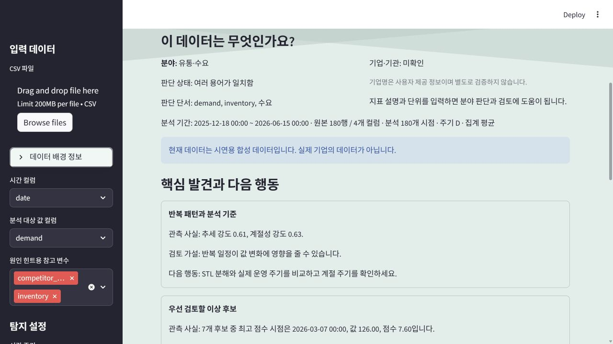
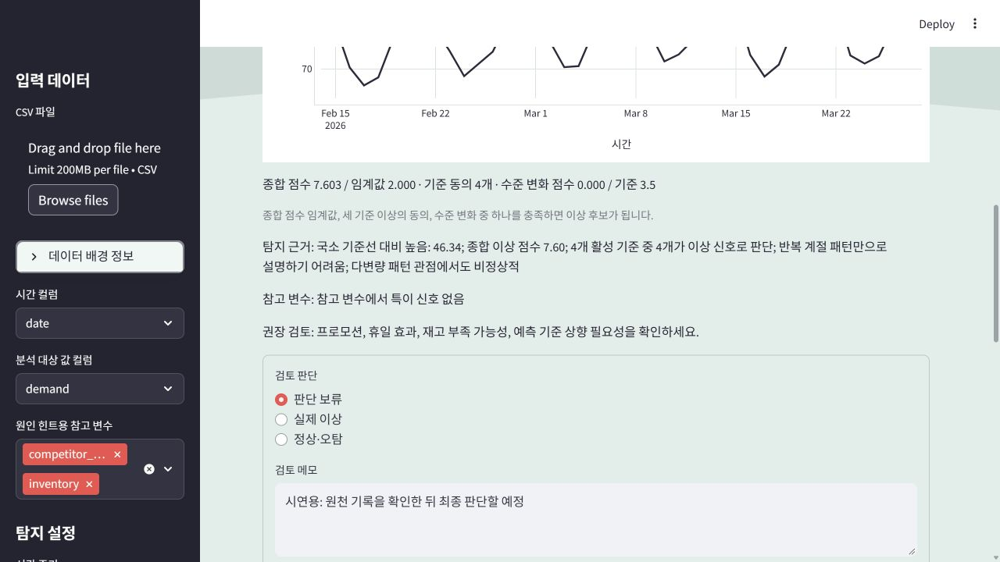
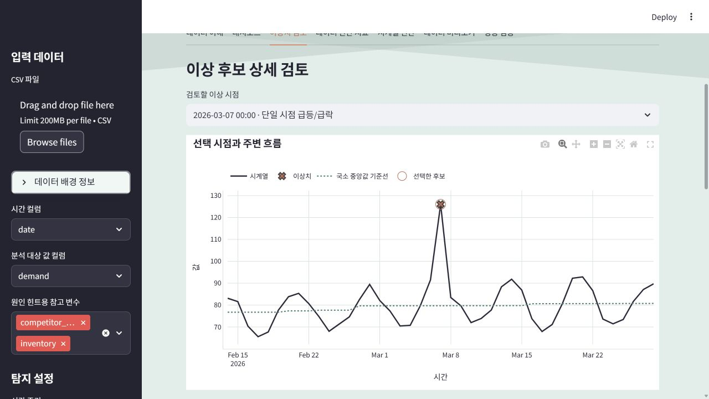

# Anomaly Intelligence | 데이터 이해와 이상탐지 대시보드

CSV를 업로드하면 데이터의 구조와 분야 단서를 설명하고, 이상 후보의 관측 근거와 다음 검토 행동을 제시하는 Streamlit 포트폴리오 프로젝트입니다.

기존 과제의 이상치 시각화를 확장해 **데이터 이해 → 주요 발견 → 분석 질문 → 검토 행동 → 성능 검증** 흐름을 구현했습니다.

[배포 앱 열기](https://kth19991213-timeseries-anomaly-app--app-qknahv.streamlit.app/) · [GitHub 저장소](https://github.com/KTH19991213/TimeSeries-Anomaly-App-)







## 해결하려는 문제

처음 보는 시계열에서 이상치를 표시하는 것만으로는 무엇을 분석하고 어떤 기록을 확인해야 할지 결정하기 어렵습니다. 이 앱은 분야 추정의 근거를 공개하고, 측정한 사실·아직 확인하지 않은 가설·다음 행동을 구분해 분석자의 검토를 돕습니다.

## 핵심 기능

- **데이터 이해:** 파일명·컬럼명·사용자 설명의 용어로 분야 추정. 근거가 부족하거나 분야가 모호하면 판단을 보류하며 사용자가 수정할 수 있습니다.
- **기업·기관 정보:** 사용자 입력으로만 표시. 숫자만으로 기업을 식별하지 않으며 입력 정보의 진위를 자동 검증하지 않습니다.
- **핵심 발견 3개:** 추세·계절성, 우선 검토 후보, 참고 변수의 상관과 데이터 품질을 관측 사실·검토 가설·다음 행동으로 설명합니다.
- **추천 질문:** 우선 검토할 시점, 반복 패턴 이탈, 추가로 필요한 데이터를 선택해 관련 그래프와 검토 계획을 확인합니다.
- **분석:** 이동 창 z-score, IQR 거리, STL 잔차, 다변량 Isolation Forest를 결합합니다. 참고 변수는 대상 하나의 탐지를 보조합니다.
- **진단:** ADF 원시·차분 비교, ACF/PACF, STL 분해, 결측·중복·주기 변환 빈 구간 확인.
- **전처리:** UTF-8/CP949/UTF-16과 구분자 자동 탐색, 시간 기반 보간, 중복 및 주기 변환의 평균·합계·마지막 값 선택. 참고 변수는 동일 시간 구간의 평균으로 집계합니다.
- **내보내기:** 탐지 CSV, 분석 Markdown, 데이터 이해·검토 계획 Markdown, 합성 평가 CSV.
- **성능 검증:** 정답 라벨이 있는 9개 합성 시계열에서 단독 방법과 앙상블 비교.
- **이상치 상세 검토:** 후보 시점 선택, 주변 관측값·국소 기준선·선택 시점 확대, 점수 임계값·기준 동의·수준 변화 근거 확인.
- **검토 기록:** 실제 이상·정상/오탐·판단 보류와 메모를 분석별 세션에 저장. JSON 다운로드·복원으로 세션 종료 후에도 이동할 수 있으며, 다른 파일·설정의 기록은 복원을 거부합니다. 서버 DB나 계정별 영구 저장은 아닙니다.
- **지속 수준 변화:** 추세·계절 위상 중앙값을 제거한 뒤 인접 구간 중앙값 변화를 비교하고 충분히 긴 이탈 구간을 후보로 추가합니다. 설정에서 끌 수 있습니다.
- **계절 주기:** 자동 또는 직접 지정. STL 탐지·진단·수준 변화가 같은 주기를 사용하며 데이터 길이가 부족하면 안내합니다.
- **분석 조건 저장:** 파일 SHA-256, 분석 ID, 선택 컬럼, 주기·집계·보간, 탐지 설정, 기업·분야 설명, 실행 환경을 JSON으로 저장. CSV에는 검토 판단·메모·분석 ID를 포함합니다.

외부 AI API를 사용하지 않으며 분석을 위해 외부 모델 서비스에 CSV를 보내지 않습니다. 분야와 설명은 용어·통계·규칙에 기반합니다.

## 실행 및 검증

Python 3.13에서 확인했습니다.

```bash
pip install -r requirements.txt
streamlit run app.py
python -m unittest test_app -v
python -m unittest test_ui -v
python -m unittest test_workflow -v
```

`app.py`, `intelligence.py`, `benchmark.py`, `workflow.py`를 같은 디렉터리에 두세요. Streamlit Community Cloud는 이 저장소의 `main` 브랜치와 루트 `app.py`를 배포 대상으로 사용합니다. 로컬 수정은 커밋·푸시한 뒤 배포 반영을 확인하세요.

## 사용 흐름

1. 내장 합성 수요 데이터로 시작하거나 날짜·수치 컬럼이 포함된 CSV를 업로드합니다.
2. 시간 컬럼, 분석 대상 하나, 참고 변수, 집계 방식을 선택합니다.
3. 사이드바의 데이터 배경 정보에서 기업·기관, 지표 단위·출처를 입력하고 분야 추정을 확인합니다.
4. 데이터 이해 화면의 주요 발견과 질문으로 검토 방향을 정합니다.
5. 이상치 검토에서 시점을 선택해 주변 흐름과 근거를 확인하고 판단·메모를 저장합니다. 검토 기록 JSON은 새 세션에서 같은 파일·설정으로 복원할 수 있습니다.
6. 성능 검증 탭에서 고정된 설정의 합성 평가를 재현합니다.
7. 데이터 진단 지표 탭에서 분석 조건 JSON을 내려받아 파일 해시·전처리·탐지 설정·환경을 보관합니다.

예제 파일은 `date_count_multivariate.csv`, `australian_tourism_monthly.csv`입니다. 관광 데이터의 출처 설명은 [Darts 데이터셋 문서](https://unit8co.github.io/darts/generated_api/darts.datasets.datasets.html)를 참고하세요.

## 검증 결과와 해석

2026-10-17 로컬 실행 결과. 주간 계절성·선형 상승 추세·잡음을 갖는 일별 180개 관측치에 seed 11·42·83을 적용했습니다. 설정은 이동 창 21, 민감도 분위수 0.94, STL·Isolation Forest 활성입니다. 단독 기준은 이동 창 z-score 절댓값 2.5 이상입니다.

각 seed의 시점별 Precision·Recall·F1을 계산한 뒤 시나리오별 산술평균을 표시합니다. 기존 앙상블·수준 변화 추가·단독 기준의 세 방법을 비교한 원본 27행은 [benchmark_results.csv](benchmark_results.csv)에 있습니다.

| 시나리오 | 방법 | Precision | Recall | F1 | 평균 오탐 수 |
|---|---|---:|---:|---:|---:|
| 단일 급등·급락 5개 | 기존 앙상블 | 0.889 | 1.000 | 0.939 | 0.667 |
| 단일 급등·급락 5개 | 앙상블 + 수준 변화 | 0.889 | 1.000 | 0.939 | 0.667 |
| 단일 급등·급락 5개 | 이동 창 z-score 단독 | 1.000 | 0.867 | 0.926 | 0.000 |
| 15일 지속 수준 변화 | 기존 앙상블 | 0.376 | 0.200 | 0.260 | 5.667 |
| 15일 지속 수준 변화 | 앙상블 + 수준 변화 | 0.684 | 0.933 | 0.788 | 6.667 |
| 15일 지속 수준 변화 | 이동 창 z-score 단독 | 0.000 | 0.000 | 0.000 | 0.000 |
| 정상 패턴 | 기존 앙상블 | 0.000 | — | — | 2.000 |
| 정상 패턴 | 앙상블 + 수준 변화 | 0.000 | — | — | 2.000 |
| 정상 패턴 | 이동 창 z-score 단독 | 0.000 | — | — | 0.000 |

정답 양성이 없는 정상 시나리오에서는 Recall·F1을 정의하지 않습니다. 예측 양성도 없을 때 Precision은 구현상 0으로 둡니다.

지속 수준 변화의 평균 F1은 0.260에서 0.788로 개선됐지만 평균 오탐은 5.667개에서 6.667개로 증가했습니다. 단일 급등·급락과 정상 시나리오 결과는 유지됐습니다. 추가 seed 127·2026에서는 미탐 감소와 수준 변화 기준의 정상 데이터 비발화를 회귀 검사합니다. 합성 평가가 실제 기업 데이터나 미지 데이터의 정확도를 입증하지는 않습니다.

## 설계와 한계

- `app.py`: Streamlit UI, 전처리, 탐지, 통계 진단, 다운로드.
- `intelligence.py`: 분야 단서 추정, 발견·가설·행동 생성, 검토 계획.
- `benchmark.py`: 재현 가능한 합성 시나리오와 라벨 평가.
- `workflow.py`: 수준 변화 구간 탐지, 분석 조건 식별 및 검토 기록 복원 검증.
- `test_app.py`, `test_ui.py`, `test_workflow.py`: 전처리 경계 사례, 기업·분야 판단 보류, 판정 일관성, UI 흐름·검토 복원·수준 변화 회귀 검사.

로컬 검증에서 20개 테스트가 통과했습니다. 파일·조건별 검토 기록 분리, 직접 지정 주기, JSON 왕복 및 다른 분석의 복원 거부를 포함합니다. STL 잔차의 MAD가 부동소수점 오차 수준일 때 표준편차로 대체해 점수가 비정상적으로 커지는 문제도 보완했습니다.

탐지 가중치는 휴리스틱입니다. 비활성·길이 부족 방법은 가중치 합에서 제외하고 나머지를 재정규화합니다. 종합 점수 임계값·3개 이상 방법의 동의·수준 변화 중 하나를 충족하면 이상 후보입니다. 수준 변화는 강건 선형 기울기와 위상 중앙값으로 조정한 뒤 인접 구간 중앙값 차이로 경계를 찾고, 구간 중앙값이 전체 기준에서 잡음 척도의 3.5배 이상 이탈하면 표시합니다. 최소 구간 길이는 이동 창과 계절 주기로 정하며 이후 관측값도 사용합니다. 느린 비선형 추세나 긴 이상 구간에서는 놓치거나 잘못 탐지할 수 있습니다.

중심 이동 창, STL, 양방향 보간은 이후 관측값을 사용합니다. 이 앱은 **회고적 일괄 분석**이며 실시간 경보나 미래 예측 모델이 아닙니다. 불규칙 시점의 자기상관·분해는 행 간격을 시간 간격으로 가정하므로 해석에 주의해야 합니다. 상관은 인과관계가 아니고 추천 행동은 확인할 가설입니다. 자동 파일 감시·분석 이력 DB·모든 변수의 동시 탐지는 구현하지 않았습니다.

후속 개선: 실제 라벨 데이터의 별도 검증 구간, 검토 기록을 이용한 임계값 교정, 계정별 영구 저장, 분석 조건 JSON의 자동 적용, 비선형 추세·장기 수준 변화 평가. 선택 후보의 검토 기록은 전체 정답 라벨이 아니므로 실제 데이터의 Recall을 계산하는 데 그대로 사용할 수 없습니다.

검증 환경: Streamlit 1.51.0 / pandas 2.3.3 / NumPy 2.2.6 / scikit-learn 1.6.1 / Plotly 6.3.0 / statsmodels 0.14.5. 배포 환경의 Python에서 설치 가능한 버전을 선택하도록 의존성은 호환 범위를 사용합니다. 실행 환경의 실제 버전은 분석 조건 JSON에 기록하며, Python·라이브러리 버전에 따라 결과가 달라질 수 있습니다.
